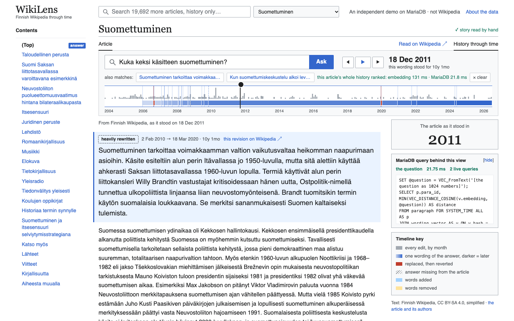
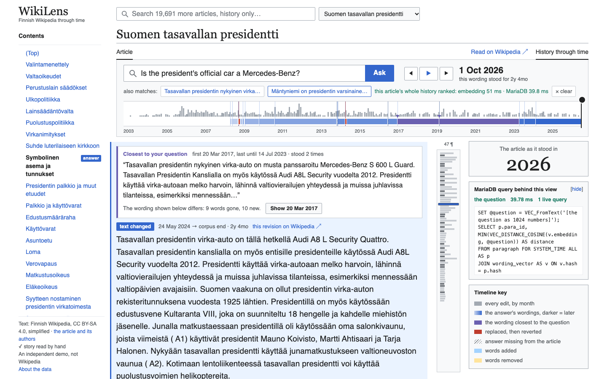

# WikiLens

Ask a Wikipedia article a question once. The paragraph that answers it lights up where it
sits in the article. Drag the timeline, and that paragraph rewrites itself word by word
through twenty years of edits, with every frame served by a MariaDB
`FOR SYSTEM_TIME AS OF` query.

Built for the MariaDB "Wikipedia Through Time" challenge at Junction 2026.






## What it does

- **No dates to pick.** One question, then a timeline you scrub. The answer changes the
  instant the playhead moves; the article around it follows from a live query.
- **Finds what was deleted.** The question is ranked against the wordings the article had at
  any time (every paragraph or list item of 40 or more characters; headings and shorter lines
  are not embedded), so an answer that was removed years ago is still found.
- **Then and now.** The wording that matches your question best may be one the article gave
  up years ago. The page says when the article read like that, quotes it, counts the words
  that differ from the wording on screen, and jumps there in a click. Ask *Is the president's
  official car a Mercedes-Benz?* of *Suomen tasavallan presidentti*: the article said so from
  2008 until May 2024, and says Audi now.
- **Shows what happened and no more.** Labels are "first appears", "text changed", "removed",
  "restored unchanged", "replaced, reverted after 7 min". None says why. Each wording of the
  answer links to its revision on Wikipedia.
- **Works before you type.** With no question, paragraphs are tinted by how often they have
  been reworded.
- **It is the article you already know how to read.** The screen follows Wikipedia's own
  layout: title, tabs, contents list. The timeline is the article's history tab, opened. The
  contents list is built from the headings at the playhead, so sections appear and vanish as
  you scrub; it marks the section holding the answer and shows how much each section has
  been reworded. Changes are drawn in Wikipedia's diff colours.
- **The whole article at a glance.** A strip beside the text draws every paragraph as a bar,
  tinted by how often it was reworded, with the answer marked and a box over the part in
  view. Press or drag on it to move. Play the timeline and the strip grows with the article.

The text is Finnish (the history dataset is Finnish Wikipedia). Questions can be asked in
Finnish or English.

## How MariaDB is used

Each paragraph of an article is **one row in a system-versioned table**. Each edit to it is a
history row stamped with the time the revision was saved on Wikipedia
(`system_versioning_insert_history`), so MariaDB's time travel is the mechanism, not a store.

```sql
-- A scrub frame: the article as it stood at one moment.
SELECT para_id, hash, rev_id
FROM paragraph FOR SYSTEM_TIME AS OF TIMESTAMP '2013-06-01 00:00:00'
WHERE page_id = 1256
ORDER BY pos, para_id;

-- The answer's whole life: one paragraph's history rows.
SELECT p.hash, p.rev_id, p.row_start, p.row_end, w.text
FROM paragraph FOR SYSTEM_TIME ALL AS p JOIN wording AS w ON w.hash = p.hash
WHERE p.page_id = 1256 AND p.para_id = 479
ORDER BY p.row_start;

-- Ask: rank every wording the article ever had, including deleted ones.
SET @question = VEC_FromText('[...1024 numbers...]');
SELECT p.para_id, MIN(VEC_DISTANCE_COSINE(v.embedding, @question)) AS distance
FROM paragraph FOR SYSTEM_TIME ALL AS p JOIN wording_vector AS v ON v.hash = p.hash
WHERE p.page_id = 1256
GROUP BY p.para_id ORDER BY distance, p.para_id LIMIT 3;
```

Only changed paragraphs are stored, each distinct wording once, and each wording is embedded
once (bge-m3, 1,024 dimensions, in a `VECTOR` column).

## Measured

On an Apple M1 Pro with MariaDB 12.3.3 in Docker. Full details, conditions and the
verified query shapes are in [docs/measurements.md](docs/measurements.md).

| | |
|---|---|
| Loaded | all 19,742 articles of the dataset, 862,076 revisions, 2003 to 1 October 2026; 0 failed |
| Load time | 8.5 minutes on 8 cores, about 1,690 revisions per second |
| Raw wikitext of those revisions | 11,599 MB |
| Text and history in MariaDB | 959 MB, about 12 times smaller: only changed paragraphs are stored |
| Embedded for questions by meaning | 50 articles (32,507 vectors, 309 MB); the rest answer by keyword |
| Frame query (`AS OF`), random articles and moments across the whole dataset | 0.6 ms median, 0.9 ms at the 95th percentile |
| Ranking an article's whole history against a question | 12 ms median, 22 ms at the 95th percentile |
| Question embedding | 20 ms |
| Correctness | for every one of the 19,742 articles, the stored state at sampled revisions equals the cleaned text of that revision |
| Dragging the whole timeline of a 2,143-revision article | every pointer move gets its own live query; 55 to 60 frames per second; no main-thread task over 50 ms |

These are database and model times. They do not include network, JSON or drawing.

## Run it

Needs Docker, Python 3.11 or later, Node 22 or later with pnpm, and
[Ollama](https://ollama.com) for questions.

```bash
cp .env.example .env                    # then set the two passwords in .env
docker compose up -d --wait             # MariaDB, pinned by digest

python3 -m venv .venv && .venv/bin/pip install -e '.[dev]'
# (the exact versions this was built and tested with are in requirements.lock.txt)
ollama serve &                          # skip if Ollama already runs
ollama pull bge-m3                      # 1.2 GB

.venv/bin/python -m wikilens.ingest --all --workers 8      # downloads the dataset (315 MB), loads all of it; about 9 minutes
.venv/bin/python -m wikilens.embed --tier1                 # vectors for 50 articles; about 30 minutes on a laptop
.venv/bin/python -m wikilens.embed --pages 1069            # the fourth story's article; about a minute

scripts/demo.sh                         # builds the page and serves http://127.0.0.1:8000
```

Once loaded and embedded, the demo runs without a network connection.

Other commands:

```bash
scripts/check.sh                                   # every test, including the browser tests
.venv/bin/python -m wikilens.stories --pages 1256  # paragraphs with eventful histories
.venv/bin/python -m wikilens.measure               # re-measure and rewrite docs/measurements.md
.venv/bin/python -m wikilens.ingest --tier1 --workers 8 # only the 50 articles that get vectors; about 3 minutes
```

## How it is built

```
dataset M (Parquet)                                  browser
      │                                                 ▲
      ▼                                                 │ frames, wordings, ask
 ingest: clean wikitext into blocks,              FastAPI (wikilens.api)
 match each block to the previous revision,             ▲
 write versioned paragraph rows                         │
      │                                                 │
      ▼                                                 │
 MariaDB:  paragraph (system-versioned) · wording · wording_vector (VECTOR) · revision
      ▲
 embed: each distinct wording once, bge-m3 through Ollama
```

- `backend/wikilens/` — Python: `cleaner`, `matcher` (which block of a new revision is the
  same paragraph as before), `history_rows`, `ingest`, `embed`, `timeline` (labels), `queries`
  (every SQL statement), `api`.
- `web/` — TypeScript, no framework: `scrub` (the playhead, one frame request in flight at a
  time), `diff` (word-level changes), `views/` (page, answer, timeline).
- `docs/` — the design and plan, [measurements](docs/measurements.md),
  [the stories read by hand](docs/stories.md), [a demo script](docs/demo-script.md).

The answer never waits for the network: its whole history arrives with the question, and the
browser changes its wording locally as the playhead moves. The article around it comes from a
live frame query for each move.

## Limits

- **Coverage.** Every article of the dataset can be scrubbed. Questions by meaning cover the
  articles that are embedded: the 50 used by MariaDB's own system-versioning starter and the
  fourth story's article. `wikilens.embed --pages` adds any other in about a minute. The
  rest answer by keyword match and say so, and "then and now" needs vectors.
- **The corpus ends on 1 October 2026.** Nothing after that is known here, and the timeline
  stops there.
- **Text is simplified.** Templates, tables and references are not shown, so edits inside
  them are not seen.
- **Paragraph identity is a judgment.** Which blocks of two versions count as "the same
  paragraph" is decided by rules (identical, moved, similar enough, restored). A weak link is
  drawn dashed and labelled "heavily rewritten". The stories the app opens with were read by
  hand; every other article says "automatic matching, not reviewed" next to its name.
- **History is shown as it was.** Vandalism appears as it was written, for as long as it
  lasted.
- **Local only.** The API listens on 127.0.0.1 and has no rate limiting or accounts. It is a
  demo, not a deployment.
- **The vector index is not used by a screen yet.** `wording_vector` has an HNSW index, and
  `docs/measurements.md` shows MariaDB using it for nearest-neighbour search. Ranking inside
  one article does not need it: it scores that article's wordings exactly. Asking across all
  articles, which would use the index, is not built.

## The film

`video/` holds a narrated film of under a minute: recordings of the real page, made by a script
that drives the running site, composed with Remotion. `video/README.md` says how to record,
voice and render it.

## Credits and licences

- Article text: Finnish Wikipedia and its authors, [CC BY-SA 4.0](https://creativecommons.org/licenses/by-sa/4.0/).
  The page links to the article and its authors, and each wording of the answer to its revision.
- Data: [MariaDB/mariadb-wikipedia-datasets](https://github.com/MariaDB/mariadb-wikipedia-datasets), dataset M.
- The wikitext cleaner is ported from
  [MariaDB/mariadb-system-versioning-wikipedia](https://github.com/MariaDB/mariadb-system-versioning-wikipedia)
  (MIT, © 2026 MariaDB Foundation; notice in `LICENSES/`), as is the way history rows are
  written with real timestamps.
- Embeddings: [BAAI/bge-m3](https://huggingface.co/BAAI/bge-m3) through Ollama.
- Layout and visual design follow Wikipedia's current skin (Vector 2022), rebuilt in this
  project's own stylesheet: no Wikimedia stylesheet file is copied, and only system fonts are
  used. WikiLens is not affiliated with Wikipedia or the Wikimedia Foundation; their logo and
  wordmark are not used, and the page says it is not Wikipedia.

No licence has been chosen for this repository's own code yet.
