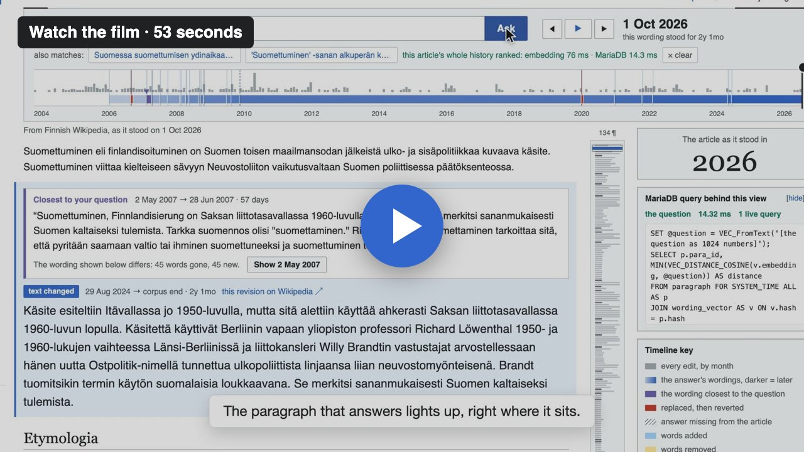
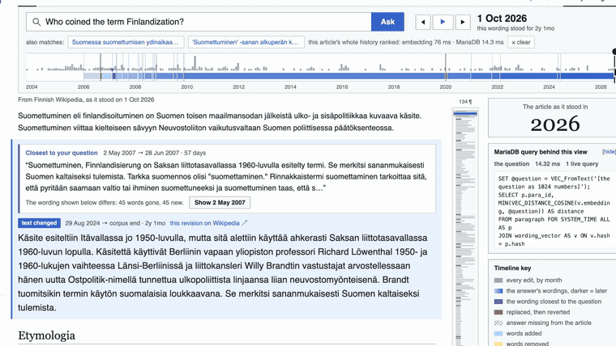
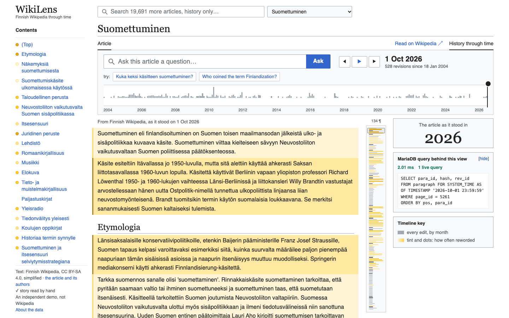
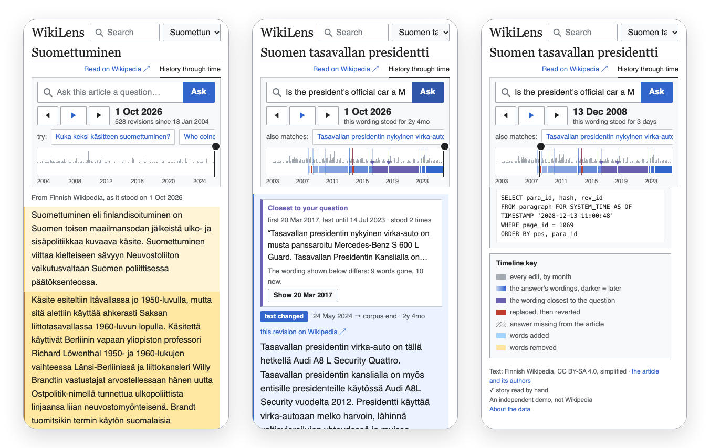

# WikiLens

Ask a Wikipedia article a question once. The paragraph that answers lights up where it sits,
and as you drag the timeline it rewrites itself, word by word, through twenty years of edits.
Every frame is one MariaDB `FOR SYSTEM_TIME AS OF` query.

**Try it:** [wikilens.pgf.lv](https://wikilens.pgf.lv) · **Watch the film (53 s):** [wikilens.pgf.lv/film](https://wikilens.pgf.lv/film/)

[](https://wikilens.pgf.lv/film/)

Built for the MariaDB "Wikipedia Through Time" challenge at Junction 2026, on all 19,742
articles and 862,076 revisions of MariaDB's Finnish Wikipedia dataset.

## What it does



- **Ask once, then scrub.** No dates to pick. The answer changes the instant the playhead
  moves; the article around it follows from a live query.
- **Then and now.** The wording that matches your question best may be one the article gave
  up years ago. The page says when it read like that, quotes it, and jumps there in a click.
  Ask *Is the president's official car a Mercedes-Benz?*: the article said so from 2008 until
  May 2024, and says Audi now.
- **Finds what was deleted.** The question is ranked against every wording the article ever
  had, so an answer removed years ago is still found.
- **Says what happened, never why.** "First appears", "text changed", "removed", "replaced,
  reverted after 7 min". Each wording links to its revision on Wikipedia.
- **Reads like the article you know.** Wikipedia's own layout, with the timeline as its
  history tab. The contents list and the overview strip follow the playhead, so sections and
  paragraphs appear and vanish as you scrub. Before you ask anything, paragraphs are tinted by
  how often they were reworded.




It works on a phone too. The article text is Finnish; questions can be asked in Finnish or
English.



## How MariaDB is used

Each paragraph is **one row in a system-versioned table**; each edit is a history row carrying
the time it was saved on Wikipedia. Time travel is the mechanism, not a store beside it, and
the question is ranked by vector search in the same database.

```sql
-- A scrub frame: the article as it stood at one moment.
SELECT para_id, hash, rev_id
FROM paragraph FOR SYSTEM_TIME AS OF TIMESTAMP '2013-06-01 00:00:00'
WHERE page_id = 1256
ORDER BY pos, para_id;

-- Ask: rank every wording the article ever had, including deleted ones.
SELECT p.para_id, MIN(VEC_DISTANCE_COSINE(v.embedding, @question)) AS distance
FROM paragraph FOR SYSTEM_TIME ALL AS p JOIN wording_vector AS v ON v.hash = p.hash
WHERE p.page_id = 1256
GROUP BY p.para_id ORDER BY distance, p.para_id LIMIT 3;
```

| Measured on a laptop, MariaDB 12.3 in Docker | |
|---|---|
| Loaded | 19,742 articles, 862,076 revisions, 2003 to October 2026, in 8.5 minutes |
| Stored | 11.6 GB of wikitext as 959 MB: only changed paragraphs, each wording once |
| A frame (`AS OF`) | 0.6 ms median |
| Ranking an article's whole history against a question | 12 ms median |
| Dragging the timeline of a 2,143-revision article | a live query per move, 55 to 60 frames a second |

How it works, and its limits: [docs/how-it-works.md](docs/how-it-works.md). Every number and
how it was measured: [docs/measurements.md](docs/measurements.md).

## Run it

Needs Docker, Python 3.11+, Node 22+ with pnpm, and [Ollama](https://ollama.com) for questions.

```bash
cp .env.example .env                    # then set the two passwords in .env
docker compose up -d --wait             # MariaDB, pinned by digest
python3 -m venv .venv && .venv/bin/pip install -e '.[dev]'
ollama pull bge-m3                      # 1.2 GB; `ollama serve` must be running

.venv/bin/python -m wikilens.ingest --all --workers 8   # downloads the dataset (315 MB) and loads it; about 9 minutes
.venv/bin/python -m wikilens.embed --tier1              # vectors for 50 articles; about 30 minutes
.venv/bin/python -m wikilens.embed --pages 1069         # and for the "then and now" story; about a minute

scripts/demo.sh                         # builds the page and serves http://127.0.0.1:8000
scripts/check.sh                        # every test, including the browser tests
```

## In this repository

| | |
|---|---|
| `backend/` | Python: cleaning wikitext, matching paragraphs between revisions, loading, embedding, the API |
| `web/` | The page: TypeScript, no framework |
| `video/` | The film: a recorder that drives the real page, the narration, the Remotion composition |
| `deploy/` | How it runs at wikilens.pgf.lv |
| `docs/` | [How it works](docs/how-it-works.md), [the design](docs/design.md), [measurements](docs/measurements.md), [the four stories read by hand](docs/stories.md), [a demo script](docs/demo-script.md) |

## Credits

- Article text: Finnish Wikipedia and its authors, [CC BY-SA 4.0](https://creativecommons.org/licenses/by-sa/4.0/).
  The page links to each article and to the revision behind each wording.
- Data: [MariaDB/mariadb-wikipedia-datasets](https://github.com/MariaDB/mariadb-wikipedia-datasets), dataset M.
- The wikitext cleaner and the way history rows get real timestamps are ported from
  [MariaDB/mariadb-system-versioning-wikipedia](https://github.com/MariaDB/mariadb-system-versioning-wikipedia)
  (MIT, © 2026 MariaDB Foundation; notice in `LICENSES/`).
- Embeddings: [BAAI/bge-m3](https://huggingface.co/BAAI/bge-m3) through Ollama. Film narration: ElevenLabs.
- The look follows Wikipedia's Vector 2022 skin, rebuilt in this project's own stylesheet.
  WikiLens is not affiliated with Wikipedia or the Wikimedia Foundation and does not use their
  logo or wordmark.

No licence has been chosen for this repository's own code yet.
